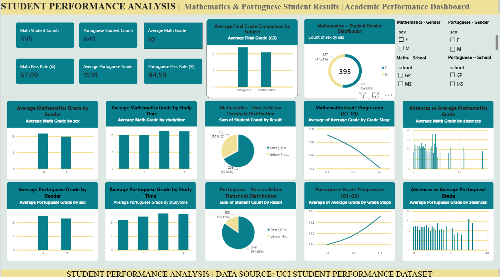
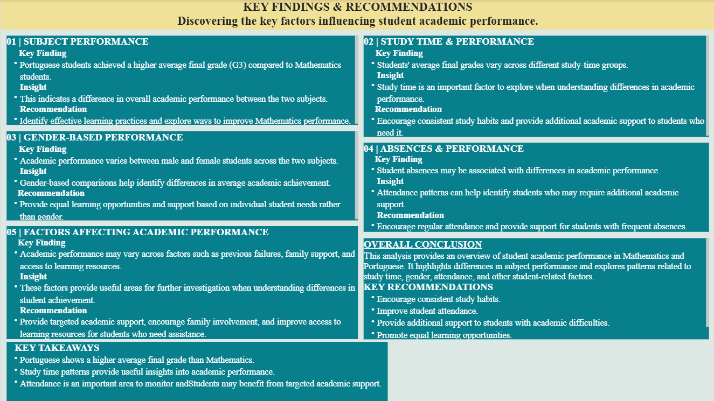

# Student Performance Analysis Dashboard

## Project Overview

This project focuses on analysing student academic performance in Mathematics and Portuguese using Microsoft Power BI.

The dashboard provides insights into student results, grade progression, study time, gender-based performance, absences, and pass-rate distribution.

## Objectives

- To analyse student performance in Mathematics and Portuguese.
- To compare the average final grades between the two subjects.
- To explore the relationship between study time and academic performance.
- To examine performance differences between gender groups.
- To analyse grade progression from G1 to G3.
- To present key findings using data visualisations.

## Tools & Technologies

- Microsoft Power BI Desktop
- Power Query
- DAX (Data Analysis Expressions)

## Dataset

The project uses the Student Performance Dataset available in the UCI Machine Learning Repository.

Two separate datasets were analysed:

- Mathematics (`student-mat.csv`)
- Portuguese (`student-por.csv`)

**Dataset Source:** https://archive.ics.uci.edu/dataset/320/student+performance

## Dashboard Pages

### 1. Student Performance Dashboard

An interactive dashboard including:

- Key Performance Indicators (KPIs)
- Subject performance comparison
- Gender-based performance analysis
- Study time analysis
- Absence analysis
- Grade progression
- Pass and below-threshold distribution

### 2. Insights & Recommendations

A summary of key findings and recommendations based on the analysis.

## Key Findings

- Portuguese students achieved a higher average final grade compared to Mathematics students.
- Portuguese students also showed a higher pass rate based on the selected threshold.
- Average grades showed an increasing trend across study-time groups in the Portuguese dataset.
- Differences in average grades between gender groups were observed in both subjects.

## Methodology

The datasets were imported and checked using Power Query. DAX measures were created to calculate student counts, average grades, and pass rates.

For this analysis, a final grade (G3) of 10 or above was used as the selected threshold for the pass-rate calculation.

## Project Status

Completed – Power BI dashboard development and analysis.

## Author

Created as part of the Syntecxhub Internship Project – Student Performance Analysis.
## Dashboard Preview

### Student Performance Dashboard

### Insights & Recommendations

